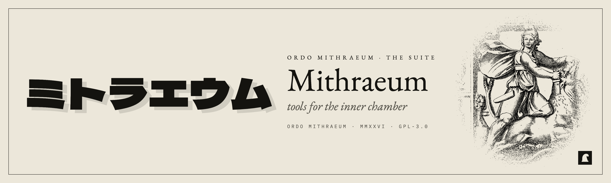

<p align="center">
  <a href="https://mithraeums.github.io">
    <picture>
      <source media="(prefers-color-scheme: dark)" srcset="assets/banner-mithraeum-night.png"/>
      
    </picture>
  </a>
</p>

<p align="center">
  <em>Tools for the inner chamber. Quiet software for people who write code by hand.</em>
</p>

<p align="center">
  <a href="https://mithraeums.github.io"></a>
  <a href="https://github.com/mithraeums"></a>
  
  
</p>

<br>

<p align="center"><sub><b>—— I ——</b></sub></p>

## Suite

<table>
  <tr>
    <td width="40" align="center"><sub><b>I</b></sub></td>
    <td width="200"><b><a href="https://github.com/mithraeums/hako-edit">hako-edit</a></b><br/><sub>箱 · the box · <code>hake</code></sub></td>
    <td>Modal text editor in a single C file. Vim-bound, language-aware, 19 themes. <code>:rei</code> answers from inside.</td>
    <td align="right"><sub><a href="https://github.com/mithraeums/hako-edit/releases"></a></sub></td>
  </tr>
  <tr>
    <td align="center"><sub><b>II</b></sub></td>
    <td><b><a href="https://github.com/mithraeums/hako-code">hako-code</a></b><br/><sub>箱 · the agent · <code>hako</code></sub></td>
    <td>Standalone terminal AI agent. Same C99 stack. 13+ providers, persistent sessions, sha-verified self-update.</td>
    <td align="right"><sub><a href="https://github.com/mithraeums/hako-code/releases"></a></sub></td>
  </tr>
  <tr>
    <td align="center"><sub><b>III</b></sub></td>
    <td><b><a href="https://github.com/mithraeums/hako">hako</a></b><br/><sub>· in officina · <code>hakm</code></sub></td>
    <td>Local models for the cursor on a from-scratch C engine. <code>hako-sho</code> (3B) + <code>hako-koi</code> (7B) live on HuggingFace; larger fine-tunes queued.</td>
    <td align="right"><sub><a href="https://github.com/mithraeums/hako/releases"></a></sub></td>
  </tr>
  <tr>
    <td align="center"><sub><b>IV</b></sub></td>
    <td><b><a href="https://github.com/mithraeums/hako-studio">hako-studio</a></b><br/><sub>箱 · in a browser · <a href="https://hako.mithraeum.studio">hako.mithraeum.studio</a></sub></td>
    <td>The same agent, compiled to WebAssembly, in a tab. Static page, no backend; also served by <code>hako --serve</code>.</td>
    <td align="right"><sub><a href="https://github.com/mithraeums/hako-studio/releases"></a></sub></td>
  </tr>
  <tr>
    <td align="center"><sub><b>V</b></sub></td>
    <td><b><a href="https://github.com/mithraeums/skills">skills</a></b><br/><sub>箱 · behaviors</sub></td>
    <td>Markdown skills in the open <a href="https://agentskills.io">Agent Skills</a> format, for the whole suite and any agent that reads them. PR-driven catalog.</td>
    <td align="right"><sub>pre-1.0</sub></td>
  </tr>
</table>

<p align="center"><sub><b>—— II ——</b></sub></p>

## Install

### hako · the agent

```sh
curl -fsSL https://mithraeums.github.io/hako.sh | sh
```

### hake · the editor

```sh
curl -fsSL https://mithraeums.github.io/hake.sh | sh
```

### hakm · the engine — native C, no ollama, no llama.cpp

```sh
curl -fsSL https://mithraeums.github.io/hakm.sh | sh
hakm pull hako-sho        # 3B weights from huggingface.co/mithraeum
```

### all three

```sh
curl -fsSL https://mithraeums.github.io/install.sh | sh
```

Where there is no release binary — iSh is 32-bit x86 — each installer builds from source.

<p align="center">
  <sub><b>macOS</b> universal2 &nbsp;·&nbsp; <b>Linux</b> x86_64 / arm64 &nbsp;·&nbsp; <b>FreeBSD</b> x86_64 &nbsp;·&nbsp; <b>Windows</b> MinGW &nbsp;·&nbsp; <b>iSh</b> (source build)</sub>
</p>

<p align="center"><sub><b>—— III ——</b></sub></p>

## Motive

<table>
  <tr>
    <td width="33%" valign="top"><b>I · Local first.</b><br/><sub>Your text, your keys, your weights. No telemetry. No silent network. The cursor is a private place.</sub></td>
    <td width="33%" valign="top"><b>II · Single binary.</b><br/><sub>One file. One C source. No JavaScript runtime to swallow your editor. The tool fits in a head.</sub></td>
    <td width="33%" valign="top"><b>III · Bring your own model.</b><br/><sub>Any model. Any provider. Any prompt. The agent is a peer at your terminal, not a stranger in the cloud.</sub></td>
  </tr>
</table>

<p align="center"><sub><b>—— IV ——</b></sub></p>

## Site

`index.html` is the whole interactive site — one hand-written static file: inline CSS, inline vanilla JS, **no build step, no framework, no third-party script, no web font, no tracker**. It's a pane-switcher (terminal home view; nav tabs slide between Suite / Install / Skills / Releases).

**One source of truth.** A single `MITH` object at the top of `index.html` holds every version, repo URL, the product copy, releases, and skills. Everything dynamic renders from it — bump a version *there*, once. The badges in this README read the repos' own tags, so they need no edit either.

**Plain mirror.** `html/index.html` is a **generated**, JavaScript-free mirror for emacs `eww`, lynx/w3m, screen readers, and offline reading — live at [`/html`](https://mithraeums.github.io/html). Do **not** hand-edit it:

```sh
node tools/build-mirror.mjs    # reads MITH out of index.html, rewrites html/index.html
```

`.github/workflows/mirror.yml` runs this on every push that touches `index.html`, so the mirror can't go stale. Custom domain `mithraeum.studio` points at this same Pages site, so `/html` is served on both.

`install.sh` is the suite installer (a menu, or `--all` / `--hako` / `--hake` / `--hakm`), and `uninstall.sh` its reverse. `hake.sh` / `hako.sh` / `hakm.sh` are one-line proxies to each repo's own `install.sh`, so a short URL never goes stale. Banner SVGs in `assets/` are referenced by every project README.

<p align="center"><sub><a href="LICENSE">— SEE LICENSE —</a> &nbsp;·&nbsp; GPL-3.0 &nbsp;·&nbsp; copyleft</sub></p>

<p align="center"><sub><em>— deus sol invictus mithras —</em></sub></p>
